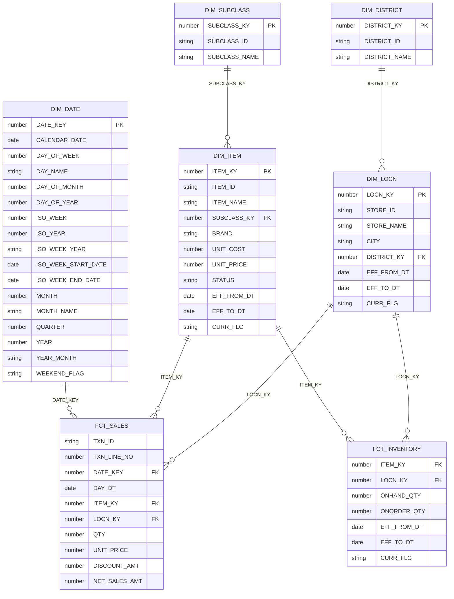
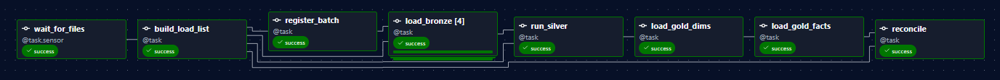
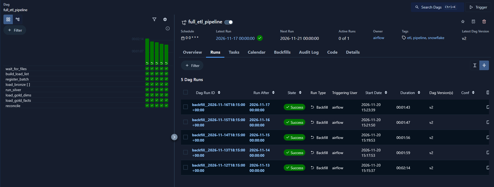
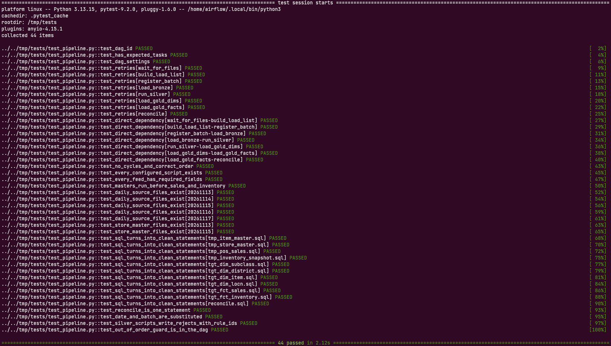
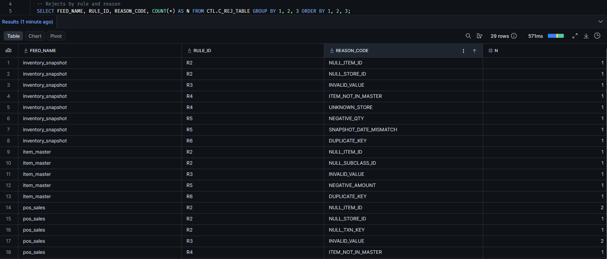
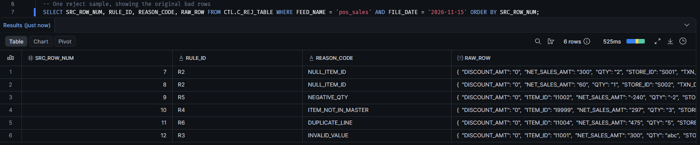
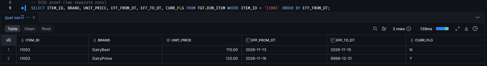
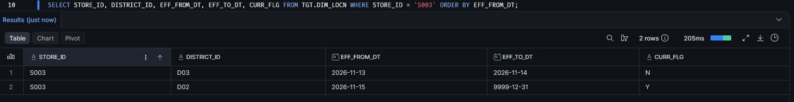
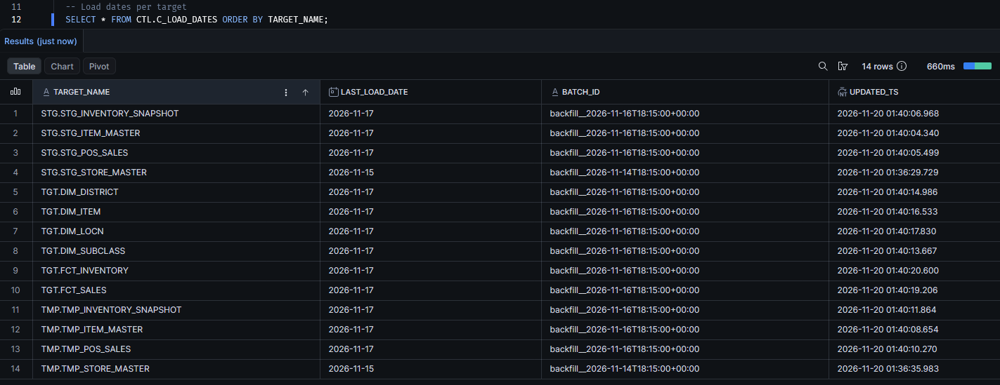
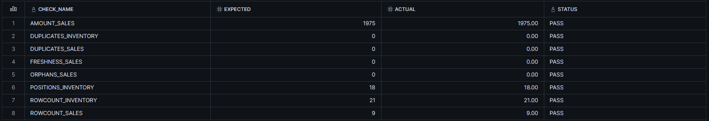

# Full Retail ETL: Airflow to Snowflake Gold

Airflow pipeline that loads four daily feeds into a Snowflake dimensional model through Bronze, Silver and Gold layers, with quality gates, rejects, reconciliation and a five-day backfill.

| Feed | Loads into |
|---|---|
| `item_master` | `DIM_SUBCLASS`, `DIM_ITEM` |
| `store_master` | `DIM_DISTRICT`, `DIM_LOCN` |
| `pos_sales` | `FCT_SALES` |
| `inventory_snapshot` | `FCT_INVENTORY` |

## Project layout

```
dags/full_etl_pipeline.py        the DAG
include/config/feeds.yaml      feeds, columns, Gold steps
include/sql/
  silver/                      Silver transformation scripts (TMP.*)
  gold/                        Gold dimension and fact scripts (TGT.*)
  control/                     reconciliation and param scripts
include/scripts/               sample data generator
model/                         DDL for STG, TMP, TGT, CTL
architecture/                  architecture, quality gates, policies
data/source/                   input CSV files
data/archive/                  copy of each loaded file
tests/test_pipeline.py         unit tests (DAG structure, config, SQL)
tests/verify_run.sql           run-result check, run in Snowsight after a backfill
tests/expected_totals.json     answer key for the sample data
docs/screenshots/              evidence images used in this README
```

## Setup

1. Start Airflow with Docker Compose (Airflow 3.3.2). The project folder is mounted at `/opt/airflow`.
2. Snowflake: run the files in `model/` in this order: `create_stg_stage.sql`, `create_stg_tables.sql`, `create_ctl_tables.sql`, `create_tmp_tables.sql`, `create_tgt_tables.sql`. Optionally run `model/load_c_batch_scripts.sql`.
3. Airflow connection `snowflake_conn` (type Snowflake) with account, user, password and warehouse `COMPUTE_WH`.
4. Airflow Variables (Admin, Variables):

| Key | Value |
|---|---|
| `source_dir` | `/opt/airflow/data/source` |
| `archive_dir` | `/opt/airflow/data/archive` |
| `sql_dir` | `/opt/airflow/include/sql` |
| `conn_id` | `snowflake_conn` |
| `database` | `RETAIL_DW` |
| `stg_schema` | `STG` |
| `stage` | `STG_SOURCE_FILES` |
| `file_format` | `FF_SOURCE_CSV` |
| `feeds_config` | `/opt/airflow/include/config/feeds.yaml` |

5. Sample data: `python3 include/scripts/generate_sample_data.py` creates `data/source/*.csv` for 13 to 17 Nov 2026 and `tests/expected_totals.json`.

## Run

- **Daily:** DAG `full_etl_pipeline`, schedule `@daily`, timezone Asia/Kathmandu, one run at a time, 2 retries 5 minutes apart. The logical date is the file date.
- **Backfill:** in the Airflow UI, trigger a backfill for 13 to 17 Nov 2026 (oldest first). To run again over completed runs, choose the option that reprocesses completed runs.

## Flow

`wait_for_files` (R1) -> `build_load_list` -> `register_batch` -> `load_bronze` (one task per file) -> `run_silver` (R2-R6 rejects, R7 gate) -> `load_gold_dims` -> `load_gold_facts` -> `reconcile` (R8 gate, then `C_LOAD_DATES`). Details: `architecture/architecture.md`.

## Quality gates and rejects

Rules R1 to R8, boundaries, failure actions and reason codes: `architecture/quality_gates.md`. Rejected rows are kept in `CTL.C_REJ_TABLE` with rule id, reason code and the original row.

## Retention, reload and recovery

`architecture/policies.md`.

## Expected results after the 13 to 17 Nov backfill

| Check | Expected |
|---|---|
| `CTL.C_BATCH_LOG` | 69 rows, no `FAILED`. `WARNING` on some Silver steps is correct (R4 rejects). |
| `CTL.C_LOAD_DATES` | `2026-11-17` for every target, `2026-11-15` for the store targets |
| `CTL.C_REJ_TABLE` | `pos_sales` 16, `item_master` 5, `inventory_snapshot` 8, `store_master` 2 |
| `DIM_SUBCLASS` / `DIM_DISTRICT` | 3 / 3 |
| `DIM_ITEM` | 7 rows (6 current, `I1003` has two versions) |
| `DIM_LOCN` | 4 rows (3 current, `S003` has two versions) |
| `FCT_SALES` | 30 rows, net 13575 NPR |
| `FCT_INVENTORY` | 88 rows, 18 open |

## Sample data

Generated by `include/scripts/generate_sample_data.py` (fixed seed, 13 to 17 Nov 2026, prices in NPR).

- **Stores:** `S001` Thamel (district `D01` Kathmandu), `S002` Patan (district `D02` Lalitpur), `S003` Bhaktapur (district `D03`). `S003` moves to `D02` from 15 Nov, which creates the `DIM_LOCN` version history.
- **Items:** 6 items in 3 subclasses. `I1003` changes brand and price from 16 Nov, and subclass `SC30` is renamed "Personal & Home Care" from 16 Nov (`DIM_ITEM` SCD2 and `DIM_SUBCLASS` SCD1).
- **Files:** `store_master` arrives only on 13 and 15 Nov, so the latest store file on or before the date is used. The other three feeds arrive daily.
- **Planted defects** (rejected rows per day, 13 to 17 Nov):

| Feed | Bronze rows | Clean rows | Rejected | Reasons planted |
|---|---|---|---|---|
| item_master | 6 / 8 / 8 / 7 / 6 | 30 in total | 0 / 2 / 2 / 1 / 0 | duplicate key, negative amount, invalid value, null subclass, null item |
| store_master | 3 / - / 5 / - / - | 6 in total | 0 / 2 | duplicate key, null district |
| pos_sales | 8 / 8 / 12 / 9 / 9 | 30 in total | 0 / 1 / 6 / 4 / 5 | null keys, unknown item or store, negative or zero quantity, negative price or discount, discount too high, net mismatch, date mismatch, duplicate line, invalid value |
| inventory_snapshot | 18 / 18 / 20 / 19 / 21 | 88 in total | 0 / 0 / 2 / 3 / 3 | null keys, unknown item or store, negative quantity, invalid value, duplicate key, date mismatch |

The answer key is `tests/expected_totals.json`. Padded and lowercase ids on 14 Nov are standardised, not rejected.

## Data model (Gold)



## Evidence

### DAG run





### Tests



### Rejects (quarantine)

Rejected rows by rule and reason (`CTL.C_REJ_TABLE`):



Sample of rejected `pos_sales` rows on 15 Nov, with the original bad values kept in `RAW_ROW`:



### History (SCD2)

`I1003` has two versions (brand and price change on 16 Nov):



`S003` has two versions (district change on 15 Nov):



### Control table

Last loaded date per target (`CTL.C_LOAD_DATES`):



### Reconciliation (R8)

All checks pass for 17 Nov:



## Tests

Run inside the Airflow container:

```bash
docker compose cp tests/. airflow-scheduler:/tmp/tests/
docker compose exec airflow-scheduler python3 -m pytest /tmp/tests/test_pipeline.py -v
```

`tests/test_pipeline.py` has 44 tests: DAG structure, order, retries, no cycles, config and SQL consistency, and parameter substitution. `tests/verify_run.sql` is run in Snowsight after a backfill and compares the loaded data with the sample-data answer key. Result: all PASS.

## Issues found and how they were handled

| Issue | Cause | Fix |
|---|---|---|
| Rerunning 13 Nov after loading to 17 Nov failed at the R8 reconcile gate: `AMOUNT_SALES` 3380 vs 3560, `ROWCOUNT_SALES` 8 vs 10, `DUPLICATES_SALES` 2, `ORPHANS_SALES` -2, `POSITIONS_INVENTORY` 18 vs 46, `DUPLICATES_INVENTORY` 18 | Gold history depends on load order. The old file looked like a change, so SCD2 added duplicate open versions of `I1003` and `S003`, and the facts joined to both | R8 caught it. Added an out-of-order guard in the DAG that fails before Gold is changed. Policy: truncate and replay from the first date (`architecture/policies.md`) |
| Sales Silver checked items and stores against raw Bronze masters, so a rejected master row still counted as existing | Early design | Switched the checks to the clean `TMP` masters and retested all five dates |
| A separate `DQ` schema was first used for rejects | Early design | Replaced by the `CTL` control schema and `C_REJ_TABLE`, as in the course standards |
| Snowsight showed only the last result of a multi-query run | Snowsight behaviour | Check queries are run one at a time |
| Tests failed with `DagBag ... include_examples` | Airflow 3.3 changed `DagBag` | Tests import the DAG object directly |

## Limitations

- **Out-of-order loads are not supported.** Gold history depends on load order. Rerunning an older date fails at the Gold step ("Out-of-order load blocked"). To fix an earlier day, truncate and replay from the first date (`architecture/policies.md`). Without the guard, an old-date rerun produced duplicate SCD2 versions and failed R8.
- **Master data on the file date.** SCD2 `EFF_FROM_DT` is the file date of the change, not a business effective date. The store file is not daily: the latest file on or before the date is used.
- **Same-day correction.** Changing a dimension attribute again on the same file date is not versioned.
- **Alerts** are `WARNING` rows in `CTL.C_BATCH_LOG`. No email or chat notification is configured.
- **File wait** uses a Python sensor on the local file system, no signal files.
- **Archive copies** the source file and does not move it.