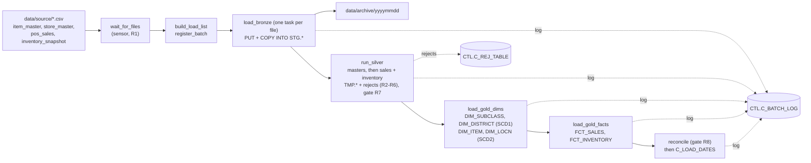

# Architecture

## Layers (database `RETAIL_DW`)

| Layer | Schema | Content |
|---|---|---|
| Bronze | `STG` | Raw rows, all `VARCHAR`, plus `SRC_FILE_NM`, `FILE_DATE`, `SRC_ROW_NUM`, `BATCH_ID`, `INGEST_TS`. One partition per `FILE_DATE`. |
| Silver | `TMP` | Typed, trimmed and uppercased clean rows, one table per source entity. |
| Gold | `TGT` | `DIM_SUBCLASS`, `DIM_DISTRICT`, `DIM_ITEM`, `DIM_LOCN`, `DIM_DATE`, `FCT_SALES`, `FCT_INVENTORY` with surrogate keys. |
| Control | `CTL` | `C_BATCH_LOG`, `C_REJ_TABLE`, `C_PARAM`, `C_LOAD_DATES`, `C_BATCH_SCRIPTS`. |

## Gold history rules

| Table | Type | Tracked attributes |
|---|---|---|
| `DIM_SUBCLASS`, `DIM_DISTRICT` | SCD1 (overwrite) | name |
| `DIM_ITEM` | SCD2 | name, subclass, brand, unit cost, unit price, status |
| `DIM_LOCN` | SCD2 | store name, city, district |
| `DIM_DATE` | Static calendar | date key, calendar date, day of week (ISO 1=Mon..7=Sun), day name, day of month, day of year, ISO week (1..53), ISO year (year containing Thursday), ISO week-year, ISO week start/end dates, month, month name, quarter, calendar year, year-month, weekend flag |
| `FCT_SALES` | Fact, grain = transaction line | joins conformed `DIM_DATE` on date key and dimension versions effective on transaction date |
| `FCT_INVENTORY` | Positional fact | one open row per item and store until quantities change |

SCD2 rows carry `ATTR_HASH`, `EFF_FROM_DT`, `EFF_TO_DT` (`9999-12-31` while open) and `CURR_FLG`. Nothing is deleted, surrogate keys stay stable.

## Idempotency

Bronze, Silver and `FCT_SALES` delete the date and insert it again. Dimensions and `FCT_INVENTORY` add or close only rows whose hash changed. See `policies.md` for reload rules.
